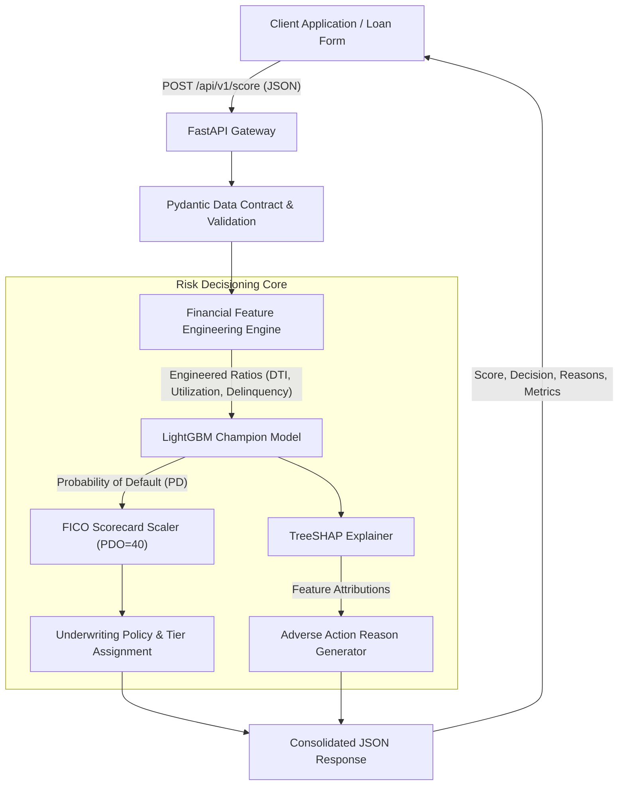

# 💳 CreditRisk-AI: Production Credit Scoring & Underwriting Microservice

A production-grade FinTech machine learning microservice that predicts consumer **Probability of Default (PD)**, transforms risk estimates into **FICO-equivalent credit scores (300–850)**, and outputs **Explainable Adverse Action notices** using TreeSHAP for regulatory compliance (FCRA / GDPR).

---

## 🏛️ System Architecture



---

## 📊 Key Highlights & Machine Learning Performance

Trained on 30,000 real borrower accounts from the benchmark UCI Credit Card Default dataset using a stratified 80/20 train-test split.

| Metric | Baseline (Logistic Regression) | Champion (LightGBM) | Financial Significance |
| :--- | :---: | :---: | :--- |
| **ROC-AUC** | `0.7336` | **`0.7807`** | Model ranking ability across all decision cutoffs |
| **Gini Coefficient** | `0.4672` | **`0.5614`** | Standard Basel II/III KPI ($2 \times \text{AUC} - 1$) |
| **KS Statistic** | `0.3990` | **`0.4238`** | Maximum separation between defaulters and non-defaulters ($>0.40$ is tier-1) |
| **Brier Score** | `0.1428` | **`0.1344`** | Probability calibration accuracy (lower is superior) |

---

## 🔍 Explainable AI (XAI) & Adverse Action Compliance

Under lending laws such as the **Fair Credit Reporting Act (FCRA)** and **GDPR**, lenders cannot reject loan applicants with unexplainable "black box" algorithms. 

This service integrates **TreeSHAP (SHapley Additive exPlanations)** to calculate exact local feature attributions for every rejected or review-flagged applicant:

```json
"adverse_action_reasons": [
  {
    "feature": "repayment_status_sept",
    "impact": 0.859,
    "reason": "Payment delay in the most recent billing cycle"
  },
  {
    "feature": "max_delinquency_6m",
    "impact": 0.376,
    "reason": "Severe payment delinquency recorded in prior months"
  },
  {
    "feature": "current_utilization",
    "impact": 0.265,
    "reason": "High current credit card utilization ratio"
  }
]
```

---

## 📈 Scorecard Scaling Formula (PDO Transformation)

Raw default probabilities are mapped to credit scores using standard actuarial **Points to Double the Odds (PDO)**:

$$\text{odds} = \frac{1 - PD}{PD}$$
$$\text{Score} = \text{BaseScore} + \left(\frac{\text{PDO}}{\ln(2)}\right) \times (\ln(\text{odds}) - \ln(\text{BaseOdds}))$$

* **Base Score:** 650 points at 4:1 odds (representing median portfolio risk).
* **PDO:** 40 points to double the odds.
* **Output Bounds:** Strictly clipped to $[300, 850]$.

---

## 📁 Repository Structure

```text
CreditScoringModel/
├── data/
│   └── raw/credit_card_defaults.csv      # Benchmark banking dataset
├── models/
│   └── credit_model_bundle.joblib        # Serialized LightGBM + TreeSHAP bundle
├── src/
│   ├── __init__.py
│   ├── download_data.py                  # Automated dataset acquisition
│   ├── features.py                       # Financial ratio engineering (utilization, delinquency)
│   ├── train.py                          # Training pipeline with Gini, KS, AUC metrics
│   ├── engine.py                         # FICO score converter, policy engine, and SHAP mapper
│   ├── schemas.py                        # Pydantic v2 schemas and validation contracts
│   └── api.py                            # Production FastAPI microservice
├── tests/
│   ├── test_engine.py                    # Unit tests for scoring math and edge cases
│   └── test_api.py                       # Integration tests for REST endpoints
├── run_demo.py                           # Interactive CLI demo for Prime vs Subprime profiles
├── Dockerfile                            # Production containerization
├── docker-compose.yml                    # One-command microservice startup
├── requirements.txt                      # Pinned dependencies
├── pytest.ini                            # Test configuration
└── README.md                             # Documentation
```

---

## 🚀 Quickstart Guide

### 1. Local Setup

```bash
# Clone the repository
git clone https://github.com/your-username/CreditScoringModel.git
cd CreditScoringModel

# Create virtual environment
python -m venv venv
# On Windows:
venv\Scripts\activate
# On Linux/macOS:
source venv/bin/activate

# Install dependencies
pip install -r requirements.txt
```

### 2. Run the Interactive CLI Demo

```bash
python run_demo.py
```

### 3. Launch the FastAPI Microservice

```bash
uvicorn src.api:app --reload --host 127.0.0.1 --port 8000
```
Open **[http://127.0.0.1:8000/docs](http://127.0.0.1:8000/docs)** to test the API with the interactive Swagger UI.

### 4. Run the Automated Test Suite

```bash
python -m pytest tests/ -v
```

### 5. Run with Docker

```bash
docker-compose up --build
```

---

## 📡 API Reference

### `POST /api/v1/score`
Scores a single applicant profile and returns risk decision + explanations.

**Sample Request Body:**
```json
{
  "limit_balance": 120000.0,
  "sex": 1,
  "education": 2,
  "marriage": 2,
  "age": 34,
  "repayment_status_sept": 0,
  "repayment_status_aug": 0,
  "repayment_status_jul": 0,
  "repayment_status_jun": 0,
  "repayment_status_may": 0,
  "repayment_status_apr": 0,
  "bill_amt_sept": 4200.0,
  "bill_amt_aug": 3900.0,
  "bill_amt_jul": 3500.0,
  "bill_amt_jun": 3000.0,
  "bill_amt_may": 2800.0,
  "bill_amt_apr": 2500.0,
  "pay_amt_sept": 4200.0,
  "pay_amt_aug": 3900.0,
  "pay_amt_jul": 3500.0,
  "pay_amt_jun": 3000.0,
  "pay_amt_may": 2800.0,
  "pay_amt_apr": 2500.0
}
```

**Sample Response Body:**
```json
{
  "credit_score": 718,
  "probability_of_default": 0.089,
  "decision": "APPROVED_WITH_CONDITIONS",
  "risk_tier": "Tier 2 (Near-Prime)",
  "recommended_action": "Approve with standard interest rate or collateral limit.",
  "adverse_action_reasons": [],
  "calculated_features": {
    "current_utilization": 0.035,
    "avg_utilization_6m": 0.0276,
    "current_pay_ratio": 1.0,
    "num_delinquent_months_6m": 0,
    "max_delinquency_6m": 0
  }
}
```

---

## ⚖️ License
MIT License. Open-source for educational and portfolio demonstration.
